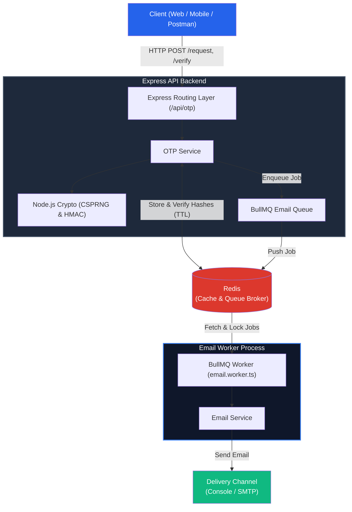

# System Architecture

This document describes the architecture of SOGS, detailing component interactions, execution flows, and data storage design.

---

## 1. Architecture Overview

SOGS operates as an asynchronous client-server system. The Express API handles client requests and OTP generation, Redis manages in-memory OTP state and job queues, and a decoupled BullMQ worker processes email delivery.

---

## 2. OTP Lifecycle

### 2.1 Generation (`POST /api/otp/request`)
1. **Validation & Normalization:** Validates request payload and normalizes the email address.
2. **Generation:** Generates a cryptographically secure 6-digit OTP using `crypto.randomInt()`.
3. **Hashing:** Computes an HMAC-SHA256 signature using `OTP_SECRET` binding `${email}:${otp}`.
4. **Storage:** Stores the hash in Redis under `otp:{email}` with a 300-second (5-minute) TTL.
5. **Asynchronous Enqueue:** Pushes an email delivery job to BullMQ (`email-queue`) in Redis, allowing the API to respond immediately (`200 OK`) without blocking on email transport.

### 2.2 Verification (`POST /api/otp/verify`)
1. **Lookup:** Fetches the stored hash from Redis using `otp:{email}`. Fails immediately if missing or expired.
2. **Hash Comparison:** Hashes incoming OTP with `OTP_SECRET` and performs comparison against stored hash.
3. **Response:** Returns success (`200 OK`) on match, or an error (`400 Bad Request`) on mismatch/expiry.

---

## 3. Data Storage & Queue Design

### 3.1 Redis OTP State
| Property | Value | Description |
|---|---|---|
| **Key Pattern** | `otp:{normalizedEmail}` | E.g., `otp:user@example.com` |
| **Value Format** | `HMAC-SHA256` string | 64-character hex digest binding `email:otp` |
| **TTL** | `300 seconds` (5 minutes) | Native auto-expiry managed by Redis |
| **Collision Policy** | Overwrite (`SET ... EX`) | Re-requesting replaces the previous hash and resets TTL |

### 3.2 BullMQ Email Queue
| Property | Value | Description |
|---|---|---|
| **Queue Name** | `email-queue` | Redis-backed queue for asynchronous email delivery |
| **Retries** | `3 attempts` | Automatic retry with exponential backoff (1s initial delay) |
| **Concurrency** | `5` (configurable) | Maximum parallel jobs processed per worker instance |
| **Retention** | `100 completed / 500 failed` | Retains recent jobs for observability and debugging |

---

## 4. Security Considerations

- **CSPRNG Generation:** `crypto.randomInt()` prevents pseudo-random predictability.
- **HMAC Pepper Hashing:** Storing HMAC hashes instead of plaintext protects OTPs against memory dumps or Redis read compromises.
- **Email Normalization:** Prevents bypasses via casing or whitespace anomalies.
- **Strict TTL Expiry:** Records are automatically evicted by Redis after 5 minutes.
