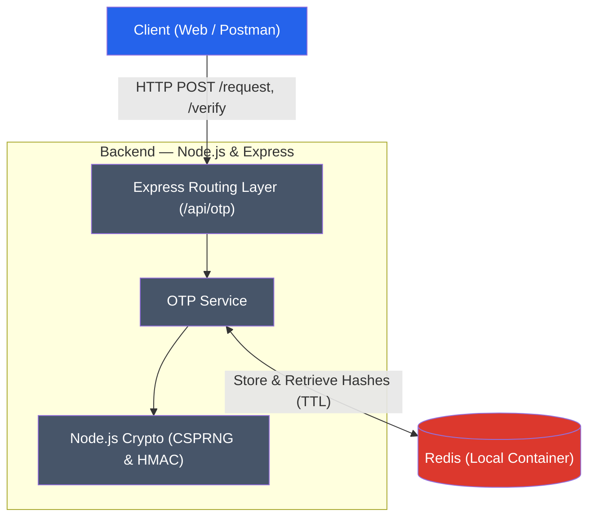

# System Architecture

This document describes the current architecture of SOGS, detailing component interactions, execution flows, and data storage design.

---

## 1. Architecture Overview

SOGS currently operates as a client-server system with an in-memory Redis cache for OTP state management.

---

## 2. OTP Lifecycle

### 2.1 Generation (`POST /api/otp/request`)
1. **Validation & Normalization**: Validates the payload and normalizes the email address.
2. **Generation**: Produces a cryptographically secure 6-digit OTP using `crypto.randomInt()`.
3. **Hashing**: Computes an HMAC-SHA256 hash using the server-side `OTP_SECRET`, binding the email and OTP (`${email}:${otp}`).
4. **Storage**: Stores the hash in Redis under `otp:{email}` with a 300-second (5-minute) TTL.

### 2.2 Verification (`POST /api/otp/verify`)
1. **Lookup**: Fetches the stored hash from Redis using `otp:{email}`. If the key is missing or expired, verification fails immediately.
2. **Hash Comparison**: Hashes the incoming OTP with `OTP_SECRET` and compares it to the stored hash.
3. **Response**: Returns success (`200 OK`) on match, or an error (`400 Bad Request`) on mismatch or expiry.

---

## 3. Data Storage Design

Redis handles all  OTP state with native TTL key eviction.

| Property | Value | Description |
|---|---|---|
| **Key Pattern** | `otp:{normalizedEmail}` | E.g., `otp:user@example.com` |
| **Value Format** | `HMAC-SHA256` string | 64-character hex digest binding `email:otp` |
| **TTL** | `300 seconds` (5 minutes) | Native auto-expiry managed by Redis |
| **Collision Policy** | Overwrite (`SET ... EX`) | Re-requesting replaces the previous hash and resets the TTL |

---

## 4. Current Security Considerations

- **CSPRNG Generation**: `crypto.randomInt()` prevents pseudo-random predictability.
- **HMAC Pepper Hashing**: Storing HMAC hashes instead of plaintext protects OTPs against memory dumps or Redis read compromises.
- **Email Normalization**: Prevents bypasses via casing or whitespace anomalies.
- **Strict TTL Expiry**: Records are automatically evicted by Redis after 5 minutes.
